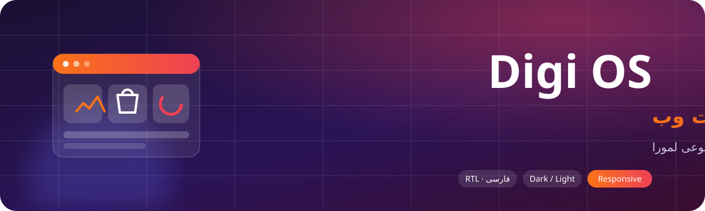
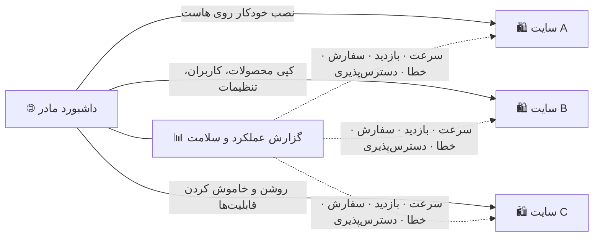

<div align="center" dir="rtl">



# Digi OS — سیستم‌عامل فروشگاهی تحت وب

**رابط کاربری (فرانت‌اند) یک پلتفرم فروشگاهی کامل فارسی:**
**ویترین فروشگاه، پنل مدیریت سایت، داشبورد مادر برای مدیریت شبکه‌ای از فروشگاه‌ها و دستیار هوش مصنوعی**


-1572b6?style=for-the-badge&logo=css3&logoColor=white)


[🛍️ ویترین فروشگاه](#-ویترین-فروشگاه) •
[🧭 پنل مدیریت](#-پنل-مدیریت-سایت) •
[🌐 داشبورد مادر](#-داشبورد-مادر) •
[🗂️ ساختار](#️-ساختار-پروژه) •
[🎨 طراحی](#-سیستم-طراحی)

</div>

---

<div dir="rtl">

## ✨ Digi OS چیست؟

**Digi OS** لایه‌ی نمایش یک فروشگاه اینترنتی کامل و بومی برای ایران است. فروشگاه، پنل مدیریت و داشبورد مادر هر سه یک زبان طراحی دارند. هر بخش کاملاً راست‌به‌چپ است، تاریخ‌ها شمسی است و روی موبایل و دسکتاپ درست کار می‌کند.

هیچ فریم‌ورک سنگین فرانت‌اندی در کار نیست. قالب‌ها **Jinja2** هستند، تعامل‌ها با **جاوااسکریپت خالص** نوشته شده و استایل‌ها **CSS** مدرن با متغیرها هستند. نتیجه، صفحه‌هایی سبک و سریع است.

| | |
|:---:|:---|
| ⚡ **سبک و سریع** | بدون React/Vue، بدون مرحله‌ی build؛ هر صفحه HTML آماده از سرور است |
| 📱 **ریسپانسیو** | از موبایل ۳۶۰ پیکسلی تا مانیتور عریض؛ جدول‌های مدیریت در موبایل کارت می‌شوند |
| 🌗 **تم روشن و تیره** | پیش‌فرض روشن، با یک کلیک تیره؛ پالت رنگ هر سایت جداگانه قابل تنظیم |
| 🇮🇷 **کاملاً فارسی** | راست‌به‌چپ، اعداد فارسی، تقویم شمسی اختصاصی، و حالت انگلیسی آینه‌ای |
| 🧩 **ماژولار** | هر قابلیت (استوری، کارت محصول، رهگیری، کیف پول…) با یک کلید روشن یا خاموش می‌شود |

---

## 🛍️ ویترین فروشگاه

<table>
<tr>
<td width="50%" valign="top">

### صفحه اصلی زنده
- 🎞️ **هدر هیرو** با اسلایدشو؛ ارتفاع جداگانه برای دسکتاپ و موبایل، یا خودکار
- ⭕ **استوری‌ها** که خودکار از دسته‌بندی‌های پرمحصول ساخته می‌شوند (وسط‌چین)
- 🔥 **تخفیف‌های ویژه** با بنر کناری و **تایمر معکوس** (روزانه، تاریخ مشخص، پایان تخفیف)
- 🔄 **پیمایش خودکار** همه‌ی اسلایدرها، با کشیدن موس و ماندگاری حرکت
- 🖼️ تصویر هر دسته از **پربازدیدترین محصول موجود** همان دسته
- 🧱 چیدمان صفحه با **کشیدن و رها کردن** بخش‌ها

</td>
<td width="50%" valign="top">

### خرید
- 🗂️ **مگامنو** با تصویر دسته‌ها
- 🔎 جستجوی زنده‌ی محصولات و دسته‌ها
- 🛒 سبد خرید با **نوار شناور موبایل** (تعداد و جمع مبلغ، بالای منوی پایین)
- 🚚 نمایش **روش‌های ارسال** با توضیحات در سبد و تسویه حساب
- 💳 پرداخت با آقای پرداخت، زیبال و کیف پول
- 📦 **پیگیری سفارش** با کد رهگیری، شرکت حمل و **تصویر بارنامه**
- 🧾 **فاکتور قابل چاپ** برای مشتری
- 🤖 **دستیار هوشمند** فروشگاه (Lemura AI)

</td>
</tr>
</table>

---

## 🧭 پنل مدیریت سایت

```text
┌─────────────────────────────────────────────────────────────────┐
│  ☰  سایدبار گروه‌بندی‌شده (جمع‌شونده، با باز شدن هنگام هاور)     │
│  ├─ داشبورد و گزارش‌های هوش مصنوعی                             │
│  ├─ سفارشات ─ مدیریت سریع · رهگیری و بارنامه · بارکد و تحویل    │
│  ├─ محصولات ─ ویژگی‌ها و متغیرها · دسته‌ها · تغییر گروهی قیمت  │
│  ├─ محتوا و ظاهر ─ صفحه اصلی · استوری · کارت‌ها · پالت رنگ     │
│  ├─ مشتریان · کیف پول · پیامک · درگاه‌های پرداخت · ترب          │
│  └─ کاربران و دسترسی‌ها (منو به منو) · پشتیبان‌گیری             │
└─────────────────────────────────────────────────────────────────┘
```

- 📋 **همه‌ی فهرست‌ها:** انتخاب تعداد نمایش، **مرتب‌سازی با کلیک روی هر ستون** (کم به زیاد / زیاد به کم) و **فیلتر لحظه‌ای** بدون دکمه‌ی اعمال
- 🏷️ **برچسب‌های رنگی وضعیت:** هر وضعیت سفارش، موجودی، نقش و پرداخت یک نقطه‌ی رنگی متمایز دارد
- 🖼️ تصویر و **متغیر** (مثلاً «رنگ: آبی») محصولات هر سفارش کنار ردیف آن
- 🖨️ **چاپ دسته‌جمعی برگه‌ی ارسال** در قالب A4 با بارکد، گیرنده، فرستنده و اقلام
- 💬 **ارسال خودکار پیامک تایید سفارش** با بررسی هوشمند ۲۴ ساعت گذشته، و ارسال دستی و گروهی
- 👥 **جستجوی زنده‌ی کاربر** با نام کاربری یا شماره موبایل برای دادن دسترسی
- ⚡ دکمه‌ی شناور **مدیریت سریع** در همه‌ی صفحه‌ها
- 👁️ مخفی‌کردن **محصولات ناموجود** و **بدون قیمت** با یک تیک

---

## 🌐 داشبورد مادر

داشبورد مادر یک فروشگاه را به **شبکه‌ای از فروشگاه‌ها** تبدیل می‌کند:



- 🚀 نصب و کلون سایت جدید، ویرایش گروهی، دسترسی شبکه‌ای برای هر بخش
- 🎨 پالت رنگ و پشتیبان‌گیری هر سایت از همان‌جا
- 📈 **گزارش عملکرد** با نمودارهای تعاملی: مقایسه‌ی قبل و بعد، زمان پاسخ، بازدیدکننده، سفارش، خطاها و دسترس‌پذیری

---

## 🗂️ ساختار پروژه

```text
digios/
├── templates/
│   ├── base.html            ← قالب پایه‌ی فروشگاه (هدر، مگامنو، نوار پایین موبایل، دستیار)
│   ├── shop/                ← صفحه اصلی، فروشگاه، محصول، سبد، تسویه، پیگیری، وبلاگ، فاکتور
│   ├── account/             ← ورود (رمز یا کد پیامکی)، ثبت‌نام، پنل کاربری، سفارش‌های من
│   ├── admin/               ← همه‌ی صفحه‌های پنل مدیریت سایت
│   └── mother/              ← داشبورد مادر و گزارش عملکرد
├── static/
│   ├── css/
│   │   ├── app.css          ← استایل ویترین فروشگاه
│   │   └── admin.css        ← استایل پنل مدیریت و داشبورد مادر
│   ├── js/
│   │   ├── app.js           ← اسلایدرها، استوری، سبد، تایمر معکوس، دستیار
│   │   ├── lists.js         ← مرتب‌سازی، تعداد نمایش و فیلتر لحظه‌ای فهرست‌ها
│   │   ├── tags.js          ← نقطه‌های رنگی وضعیت در منوهای انتخاب
│   │   └── jdp.js           ← تقویم شمسی (انتخاب تاریخ)
│   ├── icons/               ← آیکون‌های Lucide (زیرمجموعه‌ی خودکار ui.svg)
│   └── img/
└── assets/                  ← تصاویر همین README
```

> ℹ️ این مخزن **فقط بخش فرانت‌اند** است: قالب‌های Jinja2 و فایل‌های ایستا. قالب‌ها برای اجرا به بک‌اند پلتفرم (Flask) نیاز دارند که متغیرها و توابعی مثل `ic()`، `money()`، `fa()`، `jdate()` و `tag()` را در اختیارشان می‌گذارد.

---

## 🎨 سیستم طراحی

<table>
<tr>
<td align="center" width="25%"><br><b>Brand</b><br><code>--brand</code></td>
<td align="center" width="25%"><br><b>Accent</b><br><code>--accent</code></td>
<td align="center" width="25%"><br><b>Info / نمودار</b><br><code>--s1</code></td>
<td align="center" width="25%"><br><b>موفق</b><br><code>--ok</code></td>
</tr>
</table>

- 🎛️ همه‌ی رنگ‌ها **متغیر CSS** هستند. پالت هر سایت (`--brand`، `--accent`) از پنل تغییر می‌کند و تم تیره همان متغیرها را بازتعریف می‌کند.
- 🔣 آیکون‌ها از **Lucide**؛ هر صفحه فقط آیکون‌های لازم را از یک SVG Sprite سبک می‌گیرد.
- 🧱 اجزای مشترک: `card`، `kpi`، `tabs`، `badge.tag` با نقطه‌ی رنگی، `switch`، `pager` با انتخاب تعداد نمایش، `rail` (اسلایدر کشیدنی).
- ♿ پشتیبانی از `prefers-reduced-motion`، کنتراست مناسب در هر دو تم، و جدول داده برای نمودارها.

---

## 🚀 استفاده

```bash
git clone https://github.com/deveguru/digios.git
```

فولدرهای `templates/` و `static/` را در ریشه‌ی اپلیکیشن Flask قرار دهید:

```python
app = Flask(__name__, static_folder="static", template_folder="templates")
```

---

## 📜 اعتبارها

- آیکون‌ها: [Lucide](https://lucide.dev) — مجوز ISC (`static/icons/LICENSE.txt`)
- هوش مصنوعی فروشگاه: [Lemura AI](https://lemura.ir)

<div align="center">

**ساخته‌شده با ❤️ برای فروشگاه‌های ایرانی**

<sub>Digi OS · سیستم‌عامل فروشگاهی تحت وب</sub>

</div>

</div>
